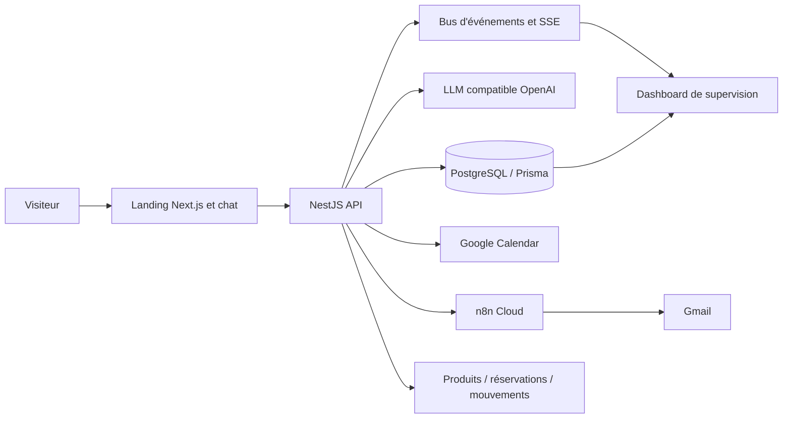

# Architecture PedalPilot

## Parcours de démonstration

## Responsabilités

| Composant | Responsabilité |
|---|---|
| `apps/web` | Landing, chat, réservation de créneau, dashboard, gestion du stock et arrêt des relances. |
| `apps/api/src/chat` | Enregistre les demandes entrantes et reprend la conversation existante du prospect. |
| `apps/api/src/qualification` | Évalue le besoin, le budget et l’urgence, lit le catalogue disponible et écrit le résultat dans le CRM. |
| `apps/api/src/events` | Persiste les événements des agents et les diffuse au dashboard avec SSE. |
| `apps/api/src/scheduling` | Calcule les créneaux, vérifie l’agenda et les réservations internes, réserve, synchronise Google Calendar et envoie la confirmation. |
| `apps/api/src/followups` | Programme et annule les relances, vérifie le consentement, prépare le texte et expose les endpoints protégés consommés par n8n. |
| `apps/api/src/dashboard` | Fournit les compteurs, fiches prospects, exécutions, mouvements de stock et actions de supervision. |
| n8n Cloud | Déclenche périodiquement les e-mails Gmail des relances et renvoie le résultat d’envoi à l’API. |

## Flux de relance

1. Le prospect saisit son e-mail et donne explicitement son accord dans le chat.
2. PedalPilot programme la première relance après 24 h. L’API reprogramme à partir du dernier message du prospect.
3. Toutes les 15 minutes, n8n appelle l’API avec `N8N_FOLLOWUP_TOKEN`. L’API réclame atomiquement les tâches dues et annule celles qui ne sont plus admissibles.
4. n8n transmet chaque e-mail à Gmail, puis appelle l’API pour enregistrer `SENT` ou `FAILED`.
5. Une deuxième tentative est programmée 72 h après la première, si le prospect reste admissible. Une réponse, un rendez-vous, la prise en main humaine ou un désabonnement annule les tâches en attente.

Les tentatives de messagerie n8n sont au moins une fois : si Gmail accepte le message mais que n8n perd la réponse avant le retour à l’API, un nouvel essai peut produire un doublon. La fenêtre de traitement expire après 10 minutes. Pour une mise en production, ajouter une clé d’idempotence au fournisseur de messagerie.

## Limites avant production

- Le dashboard est protégé par un jeton Bearer partagé. Avant de traiter des données clients en production, remplacer ce mécanisme par des comptes, une gestion de rôles et une session ou des jetons individuels.
- Le workflow Gmail gère les e-mails seulement. Telegram et WhatsApp nécessitent leurs propres accès fournisseur et leurs workflows dédiés.
- n8n Cloud doit pouvoir joindre l’API sur une adresse HTTPS publique. `localhost` ne fonctionne pas depuis n8n Cloud.
- Les clés Google, LLM, n8n et le jeton du dashboard restent dans les variables d’environnement et ne doivent pas être versionnés.
- La disponibilité Google est relue au moment d’afficher les créneaux et vérifiée de nouveau à la réservation. Les horaires d’ouverture proviennent de la configuration de l’entreprise.
